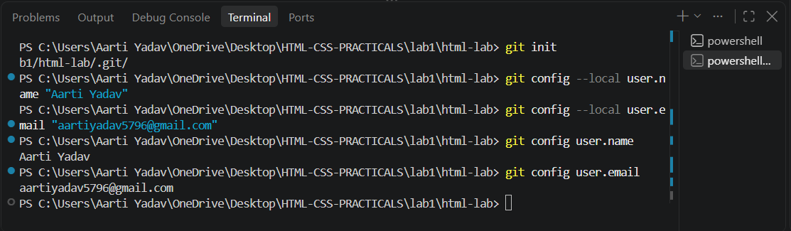
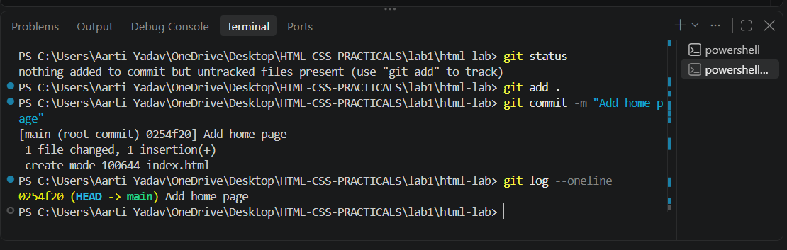
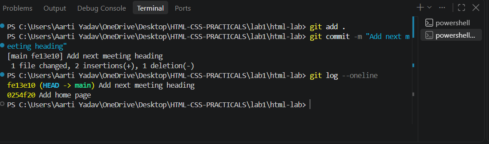

NAME: AARTI YADAV
ROLL NO: 2410303005
ID: BCS2024373

INDEX:-

List of Assignments:-
1. Starting a Git Repository
2. Pushing and Cloning a Repository
3. Your First HTML Page
4. Divs, Attributes and a Small Fix
5. Links and Images
6. Types of HTML Lists
7. About Me Page
8. Sign-Up Forms and Choices
9. Tables with Headers and Footers
10. CSS Fundamentals
11. Units and CSS Variables
12. Box Model, Cards and Scrolling
13. Flexbox Layouts
14. CSS Grid Layouts
15. Responsive Pages with Media Queries

Assignment 1: Starting a Git Repository

Aim: Start a Git repository for your lab folder and save your work with commits.

# Task 1
Create a folder named html-lab and start a Git repository in it with git init. Set your own name and email for this repository only (git config --local). Then show them with git config user.name and git config user.email.

# Theory 
Git is a version control system. It helps us to save every change made in our code, so that we can go back to any previous version at any time.

The git init command converts a normal folder into a Git repository. After this command, Git starts tracking all the files inside that folder.

The git config --local user.name and user.email commands are used to set the name and email of the person who is making the commits. Local means this setting is applied only for this repository, not for the whole computer.

The git config user.name and git config user.email commands are used to display the name and email that we have set.

# Image

Image is used for showing the terminal output of git init and git config commands.

## Task 2

Create index.html inside html-lab with one h1 heading, any text. Run git status, add the file and commit it with the message "Add home page".

# Theory
The git status command shows the current status of the repository. It tells us which files are untracked, which means Git has not saved them yet.

The git add command moves the file to the staging area. It means the file is now ready to be saved.

The git commit -m "Add home page" command creates a permanent snapshot of the file. The message describes what work was done in this commit, so that we can easily understand the history later.

# Image

Image is used for showing the git status, git add and git commit output.

## Task 3

Add a second heading, an h2, below the first one in index.html. Commit it with the message "Add next meeting heading", then run git log --oneline.

# Theory
When we make any change in a file, Git tracks that change. To save the new change, we have to run git add and git commit again. This creates a new version of the file.

The git log --oneline command shows the list of all commits in one line each. The newest commit is shown at the top and the oldest commit is shown at the bottom. This helps us to see the complete history of our project.

# Image

Image is used for showing the git log with two commits.

---

## Conclusion
In this lab, I learned how to create a Git repository, add files, commit changes and view the commit history.

