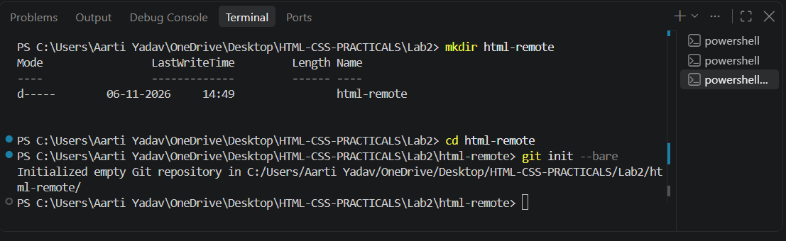
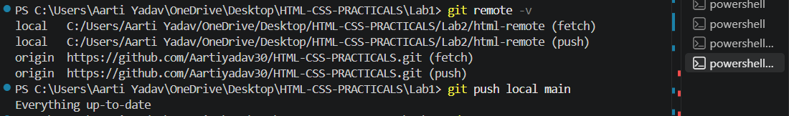
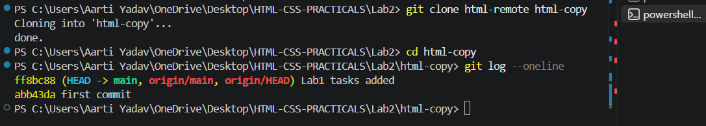

Assignment 2: Pushing and Cloning

Aim: Push your local repository to a remote repository and clone it to another folder.

# Task 1
Create a bare repository named html-remote using git init --bare. This will act as our remote repository.

# Theory
A bare repository does not have any working files. It only stores the history of the project. It is used as a remote repository where we push our code.

The git init --bare command creates a repository that only contains the .git data, without any working folder. We cannot directly edit files in it, we can only push and pull from it.

# Image

Image is used for showing the terminal output of git init --bare command.

# Task 2
Go to your html-lab folder and add html-remote as your remote using git remote add origin. Then push your code to the remote using git push origin main.

# Theory
The git remote add origin command connects our local repository to the remote repository. Origin is the short name given to the remote repository.

The git push origin main command sends all our commits from our local repository to the remote repository. After pushing, our code is safely saved in the remote repository.

# Image

Image is used for showing the terminal output of git remote add origin and git push origin main commands.

# Task 3
Clone the html-remote repository into a new folder named html-copy using git clone.

# Theory
Cloning means making a full copy of a repository. It copies all the files and the full commit history from the remote repository to our computer.

The git clone command creates a new folder named html-copy and downloads all the files from html-remote into it. Now we have two copies of the same project, the original and the cloned one.

# Image

Image is used for showing the terminal output of git clone command.

## Conclusion
In this lab, I learned how to create a bare remote repository, push my local code to it and clone it into a new folder. This helps me to keep a safe backup of my project and work from different folders.