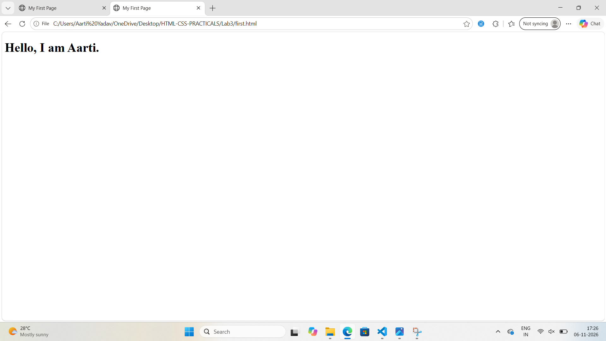
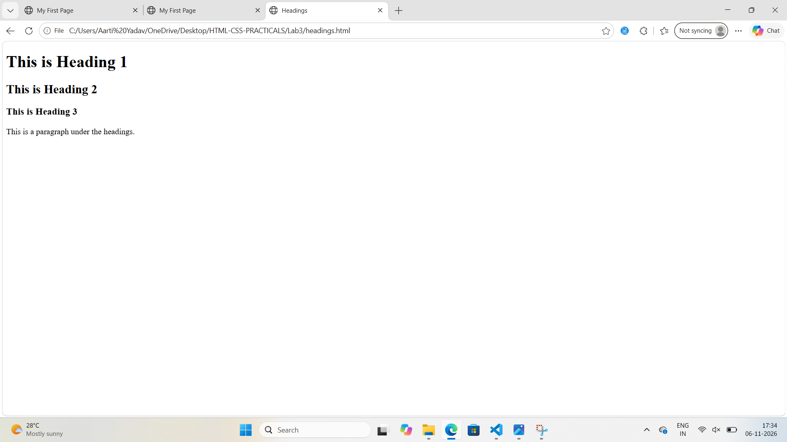
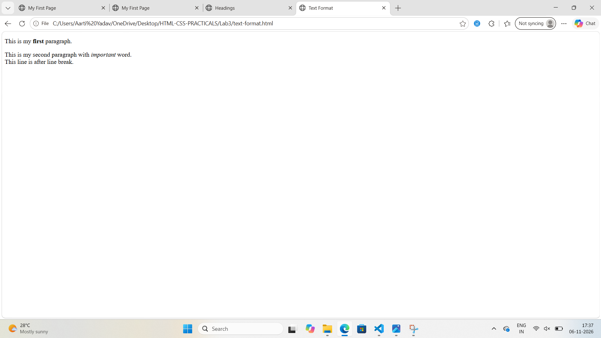

Assignment 3: HTML Basics

Aim: Learn basic HTML tags like headings, paragraphs and text formatting.

# Task 1
Create a first.html file with a heading and a paragraph.

# Theory
HTML is used to create web pages. The h1 tag is used for main heading and p tag is used for paragraph.

# Image

Image is used for showing the output of first.html file.

# Task 2
Create a headings.html file using h1, h2 and h3 tags.

# Theory
Headings are used to give titles in a web page. h1 is the biggest heading and h3 is smaller than h1 and h2.

# Image

Image is used for showing the output of headings.html file.

# Task 3
Create a text-format.html file using strong, em and br tags.

# Theory
The strong tag is used to make text bold, em tag is used to make text italic and br tag is used for line break.

# Image

Image is used for showing the output of text-format.html file.

## Conclusion
In this lab we learned how to create a basic HTML page, use headings and format text using HTML tags.