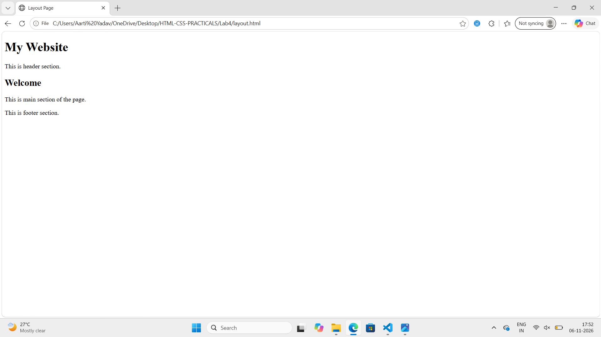
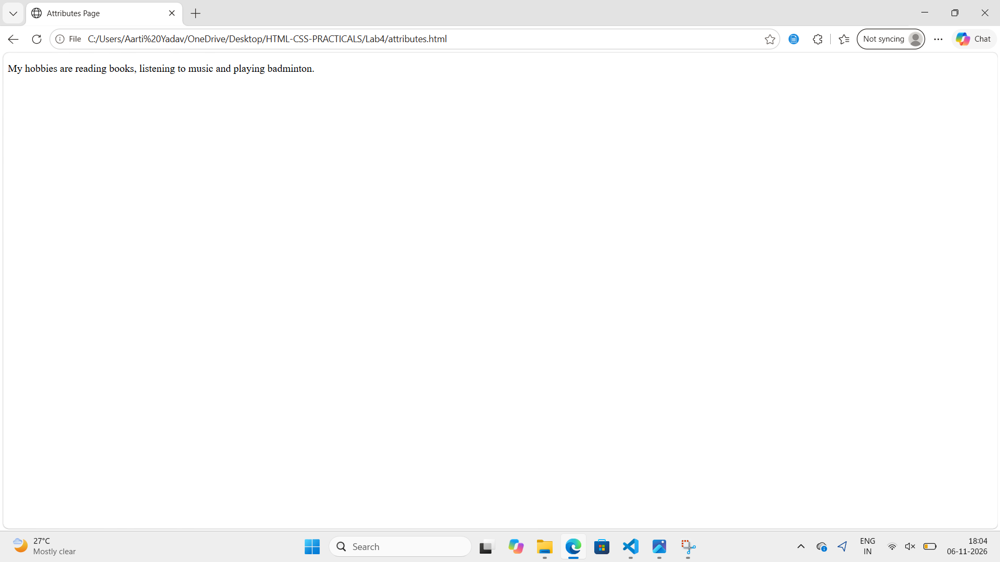
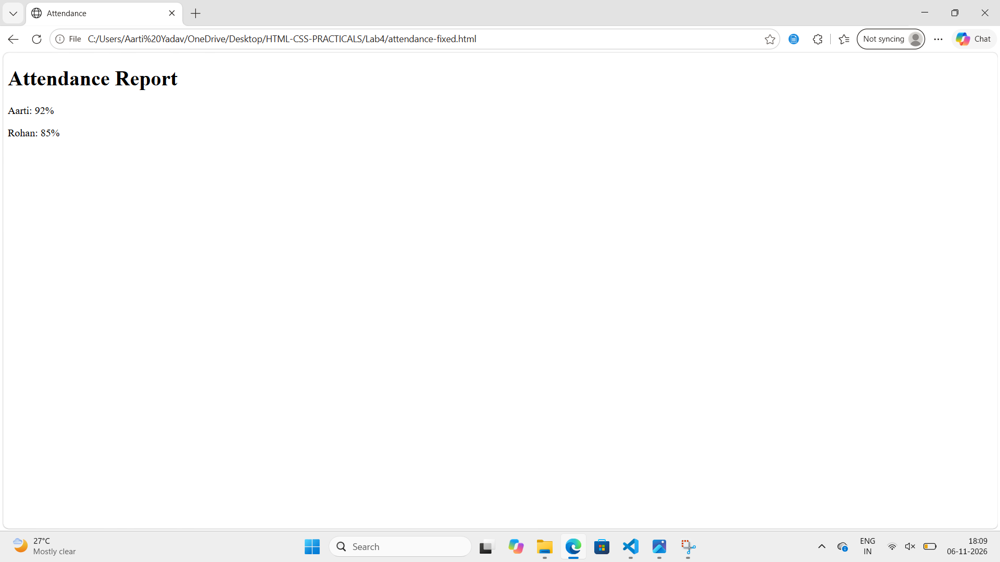

Assignment 4: Divs, Attributes and a Small Fix

Aim: Learn to use div, id, class and data attributes and fix HTML errors.

# Task 1
Create a layout.html file with three div blocks header, main and footer.

# Theory
Div is used to group parts of a page. Class is used to give same style to many elements.

# Image

Image is used for showing the output of layout.html file.

# Task 2
Create a attributes.html file with id profile and data-topic attribute.

# Theory
Id is used to give unique name to one element. Data attribute is used to store extra information which is not visible on the page.

# Image

Image is used for showing the output of attributes.html file.

# Task 3
Fix the errors in broken page and save it as attendance-fixed.html.

# Theory
Every opening tag must have a closing tag. In this page h1 tag, p tag and body tag were not closed.

# Image

Image is used for showing the output of attendance-fixed.html file.

## Conclusion
In this lab we learned how to use div, class, id and data attributes and how to fix HTML errors.