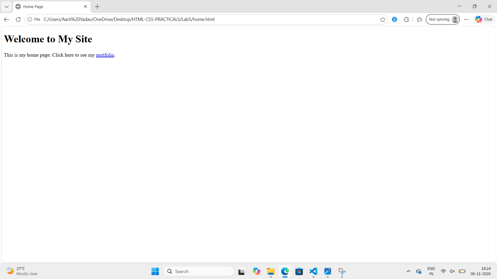
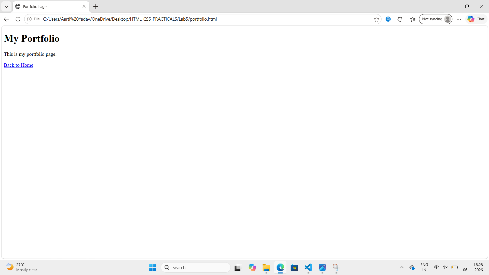
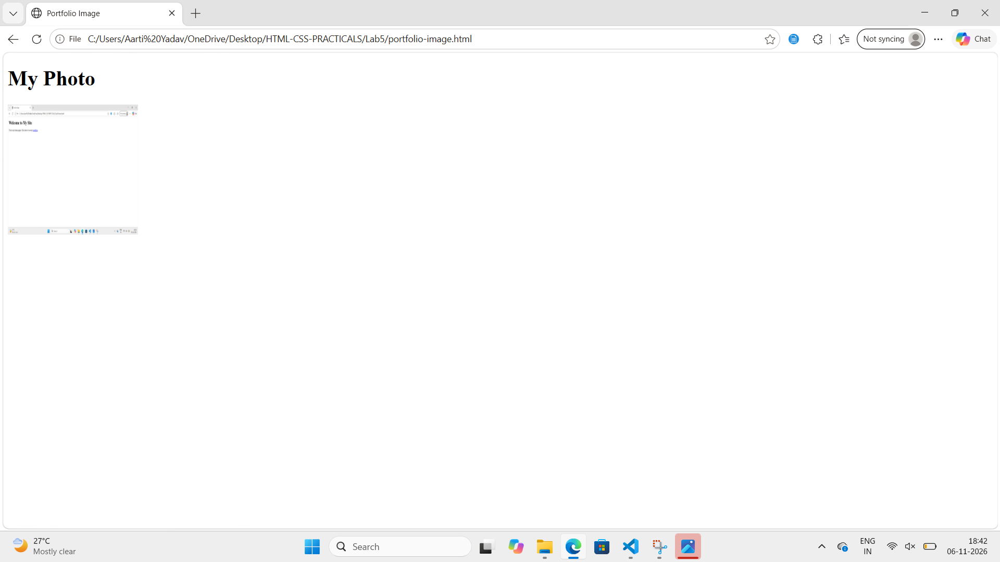

Assignment 5: Links and Images

Aim: Learn to link two pages together and add a picture with alt text.

# Task 1
Create a home.html file with a link to portfolio.html.

# Theory
The a tag is used to create a link. The href attribute tells where the link will go.

# Image

Image is used for showing the output of home.html file.

# Task 2
Create a portfolio.html file with a link back to home.html.

# Theory
Link can go from one page to another page. The link text Back to Home takes us back to home page.

# Image

Image is used for showing the output of portfolio.html file.

# Task 3
Create a portfolio-image.html file with a picture of 200x200 size.

# Theory
The img tag is used to add a picture. The src attribute gives the path of image, width and height set the size and alt text shows if picture is missing.

# Image

Image is used for showing the output of portfolio-image.html file.

## Conclusion
In this lab we learned how to create links between pages and how to add images with alt text.